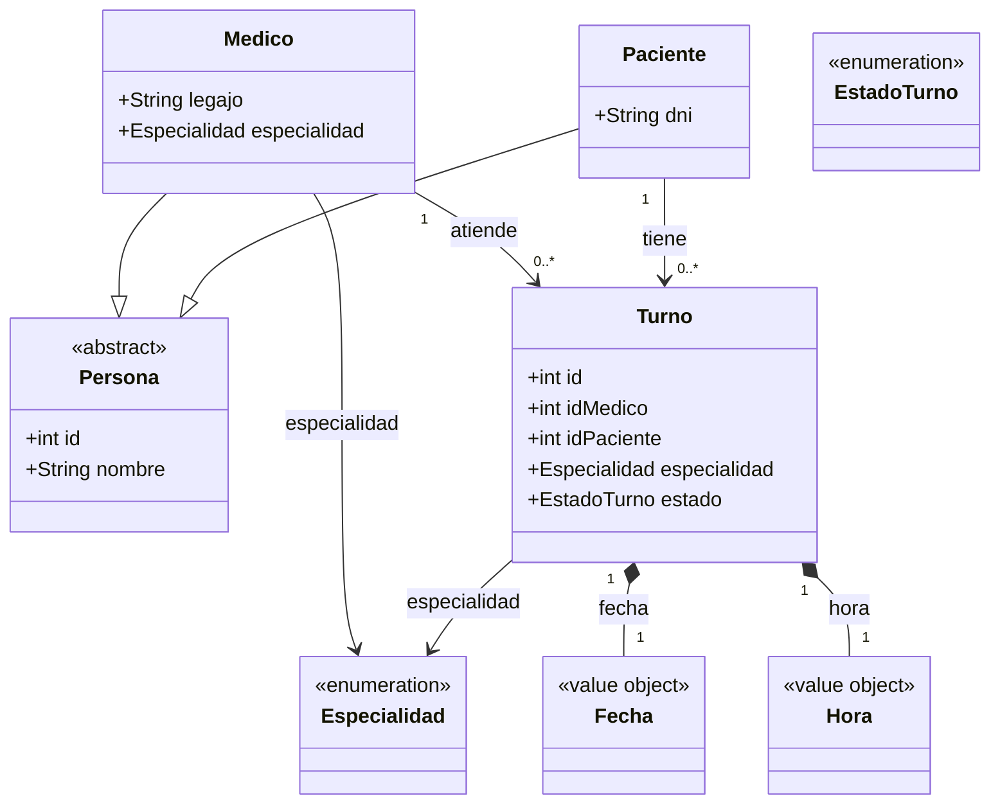

# Sistema de turnos medicos

Trabajo Practico Final de Ingenieria de Software, segundo anio de la carrera Analisis de Sistemas.

**Sistema de turnos medicos** en C++17, con interfaz de consola TUI.

## Que es

El dominio es `Medico`, `Paciente` y `Turno`, con `Especialidad` como `enum class` de doce valores.
El modelo es el de un consultorio: un medico tiene una especialidad y **no puede atender a dos
pacientes a la vez**, y el turno tiene que ser **de la especialidad del medico que lo atiende**.

## El diagrama de clases



El diagrama completo, con las reglas de negocio y la trazabilidad, esta en [docs/DiagramaDeClases.md](docs/DiagramaDeClases.md).

## Compilar y correr

Con CMake (el camino principal):
```bash
cmake -S . -B build -G Ninja && cmake --build build && ctest --test-dir build
./build/bin/sistema_turnos
```
Con Make (fallback, sin CMake; en Windows con MinGW el comando es `mingw32-make`):
```bash
make && make test && make run
```
Verificacion: `ctest --test-dir build` da 100% tests passed (0 tests failed out of 1) y
`mingw32-make test` da 594 casos y 0 fallos.

## La aplicacion

Ocho opciones: Pacientes, Medicos, Turnos, Reportes, Calendario, Configuracion, Acerca de y Salir.
Teclado primero: las flechas mueven, `Enter` elige, `0` y `Esc` vuelven; el mouse es un plus.
Sin terminal interactiva imprime el menu en texto plano y sale con codigo 0: lo que evita que el CI se cuelgue.

## Las decisiones de diseno

1. **El dominio es de TURNOS MEDICOS**, no el modelo academico con otros nombres: la exclusividad (un medico no puede atender a dos pacientes a la vez) en una facultad no tiene sentido; en un consultorio es lo obvio.
2. **La especialidad del turno es la del medico que lo atiende** (la regla 2B): es lo que hace que la especialidad deje de ser decorativa, y la interfaz hace que sea **imposible de violarla** (en "Agendar turno" se elige primero la especialidad y despues el medico, con el buscador filtrado).
3. **La persistencia es en TEXTO con un formato versionado**, no binaria: con `fwrite` de un `std::string` se mide el **objeto** (puntero + tamanho) y no los caracteres, asi que el resultado es basura; en texto los bytes son identicos en cualquier sistema operativo.
4. **El arbol binario de busqueda es propio** (no `std::map`): la busqueda por id es O(log n) **garantizado por construccion** (el arbol del repositorio esta balanceado siempre) y los tests fijan la complejidad **contando comparaciones**, no midiendo el reloj.
5. **La lista enlazada propia es la estructura de la capa de persistencia**: es el TAD del requisito de la consigna, y por ella pasan todas las lecturas y escrituras de `data/*.dat`. El **formato en disco no cambio** y la **forma del arbol no se persiste**: se reconstruye balanceado.
6. **La interfaz es una TUI propia sobre FTXUI vendorizada**, no el framework de la terminal del sistema: teclado primero, y sin terminal interactiva imprime el menu en texto plano y sale con codigo 0, que es lo que permite que el CI lo ejecute sin colgarse.
7. **La interfaz no pide ids**: donde antes habia un id de base de datos, hay un buscador (se escribe un nombre, un DNI, un legajo o una especialidad y se elige de la lista). Un id es una clave primaria de un archivo: nadie lo tiene en la cabeza.

Las 44 decisiones, con su alternativa descartada, estan en [docs/decisiones.md](docs/decisiones.md).

## Los datos

`data/` son los archivos de trabajo (los modifica la aplicacion) y `data/ejemplo/` es la semilla, que no se toca.
Los bytes son **LF, UTF-8 sin BOM** y la persistencia escribe en modo **binario**: el archivo es **identico en
cualquier sistema operativo**. En Configuracion (opcion `6`) esta la accion "Cargar datos de ejemplo".

## Estructura

```
include/    domain, entities, structures, persistence, repositories, services, ui
src/        espejo .cpp de include/       tests/  arnes de tests propio, sin framework externo
data/       los archivos de trabajo; data/ejemplo/ la semilla
third_party/  FTXUI, vendorizada           docs/  el diagrama y las decisiones de diseno
```

## Estado del proyecto

El plan completo por fases vive en el [issue #1](https://github.com/adrianbeep/final-ingenieria-software/issues/1).

| Fase | Contenido | Issue | Estado |
|---|---|---|---|
| 0 | Scaffold y build | [#5](https://github.com/adrianbeep/final-ingenieria-software/issues/5) | Completada |
| 1 | Cimientos: excepciones, validacion y fecha | [#2](https://github.com/adrianbeep/final-ingenieria-software/issues/2) | Completada |
| 2 | Entidades, operadores y catalogo de especialidades | [#3](https://github.com/adrianbeep/final-ingenieria-software/issues/3) | Completada |
| 3 | Estructuras de datos propias | [#6](https://github.com/adrianbeep/final-ingenieria-software/issues/6) | Completada |
| 4 | Persistencia | [#4](https://github.com/adrianbeep/final-ingenieria-software/issues/4) | Completada |
| 5 | Repositorios y reglas de negocio | [#14](https://github.com/adrianbeep/final-ingenieria-software/issues/14) | Completada |
| 6 | Interfaz de consola TUI: 38 pantallas | [#16](https://github.com/adrianbeep/final-ingenieria-software/issues/16) | Completada |
| 7 | Extras y cierre tecnico | — | Pendiente |
| 8 | Documentacion y defensa | — | En curso |
