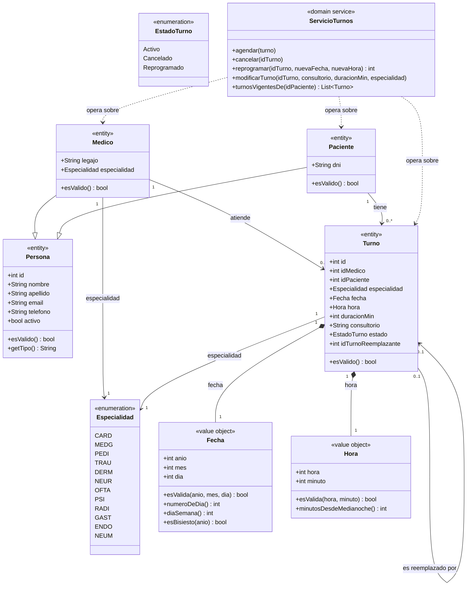
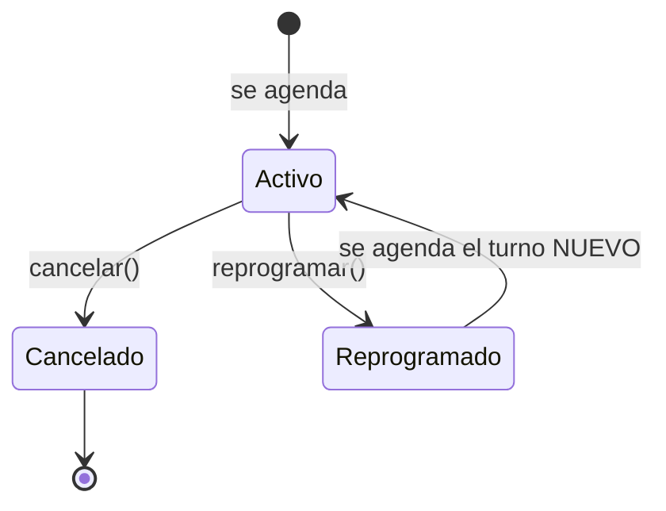

# Diagrama de clases del dominio

Este documento es el **modelo de dominio** del sistema de turnos medicos,
expresado como diagrama de clases. Es un entregable de la Fase 8.

No es una foto del codigo. Es el modelo: los conceptos del negocio, sus
atributos, sus relaciones y las reglas que los gobiernan. Por eso esta escrito
en terminos del negocio y no en terminos de la implementacion.

**La prueba de que un diagrama de clases es de dominio:** si cambiaria cada vez
que se cambia el framework o la base de datos, no es un diagrama de dominio,
es un diagrama de codigo disfrazado. Este diagrama no cambiaria si el sistema
se reescribiera con otra tecnologia.

## 1. Alcance

### Que entra

| Clase | Que es | De donde sale |
|---|---|---|
| `Persona` | Base abstracta de las personas del sistema | `include/entities/Persona.h` |
| `Medico` | Entidad: el profesional que atiende | `include/entities/Medico.h` |
| `Paciente` | Entidad: quien recibe la atencion | `include/entities/Paciente.h` |
| `Turno` | Entidad: el vinculo entre medico, paciente, fecha y hora | `include/entities/Turno.h` |
| `Especialidad` | Enumeracion: catalogo cerrado de 12 especialidades | `include/domain/Especialidad.h` |
| `EstadoTurno` | Enumeracion: ciclo de vida del turno | `include/entities/Turno.h` |
| `Fecha` | Objeto de valor: fecha del calendario | `include/utils/Fecha.h` |
| `Hora` | Objeto de valor: hora del dia | `include/utils/Fecha.h` |
| `ServicioTurnos` | Servicio de dominio: donde viven las reglas | `include/services/ServicioTurnos.h` |

### Que no entra, y por que

| Fuera | Por que |
|---|---|
| `IRepositorio`, `IRepositorioBajaLogica`, `RepositorioCRUD`, `RepositorioMedicos`, `RepositorioPacientes`, `RepositorioTurnos`, `BajaLogicaCompartida` | Persistencia y acceso a datos. El dominio no depende de como se guardan las cosas |
| `ArchivoTexto` | Formato de archivo. Es infraestructura |
| `ArbolBST`, `ListaEnlazada` | Estructuras de datos. No son conceptos del negocio |
| `Utils` | Helpers de texto |
| Jerarquia de excepciones | Mecanismo de reporte de errores, no conceptos |
| Todo `ui::` (pantallas, motor CRUD, temas, tablas, calendarios) | Capa de presentacion. El dominio no depende de la terminal |
| `main.cpp` | Composition root: solo despacho |

La razon es una sola y es la misma para todos: **el diagrama de dominio
documenta el negocio, y el negocio no sabe que existen archivos, arboles ni
terminales**. Si estas clases aparecen en el diagrama, el diagrama deja de
servir para lo unico que sirve: explicar el modelo.

> `Fecha` y `Hora` viven en `include/utils/`, pero **no son utilidades
> tecnicas**: son valores del calendario del consultorio (ventana de atencion
> 08:00-22:00, granularidad de 30 minutos, rango 2000-2100). La unica utilidad
> tecnica de esa carpeta es `Utils`.

## 2. El diagrama

### Como leer el diagrama

- **Generalizacion** (`--|>`): `Medico` y `Paciente` son `Persona`. Un `Turno`
  **no** es una `Persona`: heredar seria un "es-un" falso.
- **Composicion** (rombo lleno `*--`): `Turno` *contiene* `Fecha` y `Hora`. Son
  valores: se copian, se comparan y no tienen identidad propia.
- **Asociacion simple** (`-->`): `especialidad` es un valor del catalogo
  compartido, no una parte con ciclo de vida propio. Por eso NO es composicion.
- **Dependencia** (`..>`): `ServicioTurnos` usa las entidades, pero no las
  contiene ni las controla. Las flechas punteadas son las unicas dependencias
  del diagrama: los repositorios que el servicio recibe por inyeccion son
  infraestructura y no se dibujan.
- **Multiplicidad `0..1` en la autoasociacion de `Turno`**: un turno
  reprogramado apunta a su turno reemplazante. El turno nuevo no apunta a
  ninguno.

## 3. Las clases, una por una

### `Persona` (abstracta)

Atributos comunes de toda persona del sistema. `activo` es la **baja logica**:
la entidad se oculta pero no se elimina (decision 10).

| Atributo | Tipo | Regla |
|---|---|---|
| `id` | `Int` | Lo asigna el repositorio, nunca el usuario. Unico **por tipo de entidad**: `Medico(5)` y `Paciente(5)` son personas distintas |
| `nombre` | `String` | Alfabetico, no vacio |
| `apellido` | `String` | Alfabetico, no vacio |
| `email` | `String` | 5 a 60 caracteres, contiene `@`, alfabeto `letras+digitos+.@-_` |
| `telefono` | `String` | 7 a 20 caracteres, solo digitos, `+`, `-` y espacios |
| `activo` | `Boolean` | `false` = dado de baja logicamente |

**Operaciones de dominio**

| Operacion | Que hace |
|---|---|
| `esValido()` | El conjunto de datos es legal y completo |
| `getTipo()` | Discriminador: `"Medico"` o `"Paciente"` |

### `Medico`

| Atributo | Tipo | Regla |
|---|---|---|
| `legajo` | `String` | 4 a 12 caracteres, `letras+digitos+-_`. Unico en el sistema (comparacion **case-insensitive**) |
| `especialidad` | `Especialidad` | Exactamente **una**. Un medico tiene UNA especialidad (decision 15) |

Agrega a los de `Persona`. `esValido()` = `Persona::esValido()` + legajo valido.

### `Paciente`

| Atributo | Tipo | Regla |
|---|---|---|
| `dni` | `String` | 7 u 8 caracteres, **todos numericos**. Unico en el sistema (comparacion exacta) |

Agrega a los de `Persona`. `esValido()` = `Persona::esValido()` + dni valido.

### `Turno`

Es la **relacion** entre un medico, un paciente, una especialidad, una fecha y
una hora. Es la entidad central del sistema.

| Atributo | Tipo | Regla |
|---|---|---|
| `id` | `Int` | Lo asigna el repositorio. Unico en el sistema |
| `idMedico` | `Int` | Debe existir un `Medico` con ese id y estar **activo** |
| `idPaciente` | `Int` | Debe existir un `Paciente` con ese id y estar **activo** |
| `especialidad` | `Especialidad` | Debe coincidir con la del medico que atiende (regla 2b) |
| `fecha` | `Fecha` | No puede estar en el pasado. Rango 2000-2100 |
| `hora` | `Hora` | Dentro de 08:00-22:00, minuto multiplo de 30 |
| `duracionMin` | `Int` | Positiva, multiplo de 15, maximo 240. El turno debe **terminar** antes de las 22:00 |
| `consultorio` | `String` | 1 a 20 caracteres, `letras+digitos+espacios+-.` |
| `estado` | `EstadoTurno` | `Activo`, `Cancelado` o `Reprogramado` |
| `idTurnoReemplazante` | `Int` | `-1` = nadie lo reemplazo. Ver ciclo de vida |

> **Nota sobre las referencias:** `Turno` no guarda un `Medico*` ni un
> `Paciente*`: guarda el **id**. La existencia y la baja de las personas las
> verifica `ServicioTurnos`, no la entidad. Por eso el diagrama las muestra
> como asociaciones y no como composicion.

### `Especialidad` (enumeracion)

Catalogo **cerrado** de 12 valores: `CARD` (Cardiologia), `MEDG` (Medicina
General), `PEDI` (Pediatria), `TRAU` (Traumatologia), `DERM` (Dermatologia),
`NEUR` (Neurologia), `OFTA` (Oftalmologia), `PSI` (Psiquiatria), `RADI`
(Radiologia), `GAST` (Gastroenterologia), `ENDO` (Endocrinologia), `NEUM`
(Neumologia).

No es una entidad: no tiene id, no se persiste, no tiene CRUD (decision 1). Se
**elige de una lista**, nunca se escribe: el estado invalido es
irrepresentable.

### `EstadoTurno` (enumeracion)

`Activo`, `Cancelado`, `Reprogramado`. Es la maquina de estados del turno
(seccion 5).

### `Fecha` y `Hora` (objetos de valor)

| | Atributos | Validacion |
|---|---|---|
| `Fecha` | `anio`, `mes`, `dia` | La fecha existe en el calendario y esta entre 2000 y 2100 |
| `Hora` | `hora`, `minuto` | Dentro de la ventana de atencion (08:00-22:00) y minuto multiplo de 30 |

No tienen identidad: dos `Fecha(2027, 3, 10)` son el mismo valor. Se copian y
se comparan.

### `ServicioTurnos` (servicio de dominio)

Es la **capa de reglas de negocio** de los turnos. No tiene estado propio:
recibe sus colaboradores por inyeccion y no los contiene.

| Operacion | Que hace |
|---|---|
| `agendar(turno)` | Agenda un turno nuevo si pasan TODAS las reglas. No asigna el id (lo hace el repositorio) |
| `cancelar(idTurno)` | Baja logica: el turno pasa a `Cancelado` y **libera su horario**. No se borra |
| `reprogramar(idTurno, fecha, hora)` | Crea un turno **nuevo** con la nueva fecha/hora y deja el viejo en `Reprogramado` apuntando al nuevo. Devuelve el id del nuevo |
| `modificarTurno(idTurno, consultorio, duracion, especialidad)` | Cambia consultorio, duracion y especialidad de un turno `Activo`. La fecha y la hora **no** se cambian: eso es reprogramar |
| `turnosVigentesDe(idPaciente)` | Los turnos `Activo` de un paciente |

Ademas expone consultas de listado (por paciente, medico, especialidad, fecha
y rango de fechas). Son lecturas: no aplican reglas y no lanzan errores por
entidad inexistente.

> **Por que el servicio esta en un diagrama de dominio y los repositorios no:**
> el servicio decide **si un turno puede existir**. Los repositorios solo
> guardan y devuelven entidades: no saben si dos turnos se solapan. El
> servicio es dominio puro (no hace I/O); el repositorio es infraestructura.

## 4. Reglas de negocio

### 4.1 Identidad

| # | Regla |
|---|---|
| I1 | El `id` lo asigna el repositorio, nunca el usuario |
| I2 | La identidad de una `Persona` es `(id, tipo)`: el `id` es unico **por tipo de entidad** |
| I3 | La identidad de un `Turno` es el `id` |

### 4.2 Agendamiento

Se aplican todas en bloque. Si una sola falla, **no se escribe nada**: el
repositorio queda como estaba.

| # | Regla | Falla con |
|---|---|---|
| A1 | El paciente existe y esta activo | `EntidadNoExisteException` / `DatoInvalidoException` |
| A2 | El medico existe y esta activo | idem |
| A3 | La especialidad del turno es la del medico que lo atiende (regla 2b) | `DatoInvalidoException` |
| A4 | La fecha no esta en el pasado (hoy si se puede agendar) | `DatoInvalidoException` |
| A5 | Los datos propios del turno son validos (duracion, hora, consultorio, fin antes de las 22:00) | `DatoInvalidoException` |
| A6 | El turno no se superpone con otro, **en ninguno de los dos ejes** | `TurnoOcupadoException` |

### 4.3 Exclusividad (la regla central del consultorio)

> **Un medico no puede atender a dos pacientes a la vez, y un paciente no
> puede tener dos turnos a la vez.**

| # | Regla |
|---|---|
| E1 | Dos turnos se superponen si `(inicioA < finB) && (inicioB < finA)`: el solapamiento se evalua sobre **intervalos**, no sobre horarios de inicio |
| E2 | Dos turnos que solo se tocan **no** se superponen: 10:00-10:45 y 10:45-11:30 conviven |
| E3 | El control se dispara si coincide el **medico** o coincide el **paciente** |
| E4 | Solo los turnos `Activo` bloquean el horario: un turno `Cancelado` o `Reprogramado` **libera** su espacio |
| E5 | No existe un tope numerico de turnos por dia ni por franja: la unica restriccion es el solapamiento de intervalos |

### 4.4 Ciclo de vida del turno

| # | Regla |
|---|---|
| C1 | `Cancelado` y `Reprogramado` son **estados finales**: solo un turno `Activo` se puede cancelar, reprogramar o modificar |
| C2 | Cancelar es una **baja logica**, nunca un borrado fisico: el turno sigue existiendo con su historial (decision 10) |
| C3 | Cancelar **no es idempotente**: cancelar un turno ya cancelado es un error, no un no-op silencioso (es lo que esconde un doble clic) |
| C4 | Reprogramar crea un turno **nuevo**: el viejo queda `Reprogramado` y apunta al nuevo (decision 8). Devuelve el id del nuevo |
| C5 | Reprogramar **no puede esquivar las reglas**: se aplica el juego completo de reglas de `agendar` al turno nuevo, y si alguna falla **no se modifica ninguno de los dos turnos** |
| C6 | Reprogramar a un horario ocupado **por el propio turno viejo** es un error: durante la validacion el viejo sigue `Activo` y se ve a si mismo |
| C7 | `modificarTurno` solo cambia consultorio, duracion y especialidad. La fecha y la hora son inmutables en un turno existente |
| C8 | `modificarTurno` **no** re-aplica la regla 2b: cambiar la especialidad de un medico es legitimo y sus turnos anteriores conservan la suya (decision 32) |
| C9 | `modificarTurno` puede modificar un turno que ya esta en el pasado: no se le aplica la regla A4 |
| C10 | `modificarTurno` no colisiona consigo mismo: la verificacion de solapamiento excluye el turno que se esta modificando |

### 4.5 Unicidad y baja logica

| # | Regla | Donde vive |
|---|---|---|
| U1 | El `legajo` del medico es unico en el sistema (case-insensitive) | Repositorio: la entidad no conoce el conjunto |
| U2 | El `dni` del paciente es unico en el sistema (exacto) | Repositorio: idem |
| U3 | La baja logica de medico y paciente es una operacion de repositorio: el dominio no necesita saber que existe un repositorio | Repositorio |

> **U1 y U2 son reglas de negocio implementadas fuera del dominio.** Se
> documentan aca porque son reglas del negocio, pero conviene saber que la
> entidad no las puede cumplir sola: no ve el conjunto de los medicos.

## 5. Trazabilidad con el codigo

| Clase del diagrama | Archivo |
|---|---|
| `Persona`, `Medico`, `Paciente`, `Turno`, `EstadoTurno` | `include/entities/` |
| `Especialidad` | `include/domain/Especialidad.h` |
| `Fecha`, `Hora` | `include/utils/Fecha.h` |
| `ServicioTurnos` | `include/services/ServicioTurnos.h` |

Las reglas de la seccion 4 estan implementadas en `ServicioTurnos`, salvo la
existencia y el estado de las personas, que se resuelven ahi tambien contra
los repositorios inyectados.

## 6. Regla de mantenimiento

**Si cambia el dominio, cambia este documento en el mismo commit.** Un
diagrama desactualizado es peor que no tener diagrama: el que lo lee supone
que dice la verdad.

Y si alguna vez hace falta agregar una clase tecnica a este diagrama para
"completarlo", la señal es que lo que falta es otro diagrama, no una clase mas
en este.
